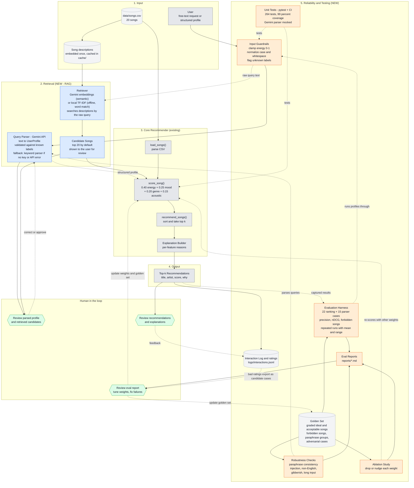

# System Architecture

This diagram shows the existing content-based recommender (grey) and the two planned enhancements: a **RAG retrieval layer** (blue) and a **reliability / testing system** (orange). Human checkpoints are shown in green.

## How to read it

**Data flow (input, process, output)**
1. The user's request passes through the input guardrails, which clamp and normalize it.
2. Two things happen in parallel. The Gemini-powered query parser turns the request into a `UserProfile`, checked against the known genre and mood labels (a keyword parser takes over if there is no key or the call fails). Separately, the retriever embeds the raw query text and finds the 20 songs whose descriptions are closest in meaning.
3. The existing `score_song()` and `recommend_songs()` rank only those candidates. Scoring stays deterministic and explainable. Without a query (a ready-made profile), the whole catalog is ranked.
4. The output is the top-k list with a reason for each score, and the retrieved candidates are shown for review.

**Testing**
- **Unit tests** (pytest, run in CI) cover guardrails, scoring, both parsers, the retriever and the evaluation code itself. The Gemini calls are faked, so no key is needed.
- The **evaluation harness** scores ranking quality against a golden set with graded relevance and forbidden songs, and repeats runs to show variance for the non-deterministic parser. The **robustness checks** test paraphrases and adversarial input, and the **ablation study** re-scores with different weights. Reports are written to `reports/`.
- The retrieval experiment compares embedders and candidate-pool sizes on the free-text cases.

**Human checkpoints**
- **H1** checks that the parsed profile and retrieved candidates make sense before ranking, since this is where RAG can go wrong.
- **H2** is the user or developer reading the recommendations and explanations. `python -m src.feedback` logs a good or bad rating, and bad ratings export as skeleton golden-set cases.
- **H3** reviews the eval report and decides on weight changes or golden-set updates. Nothing changes automatically.
