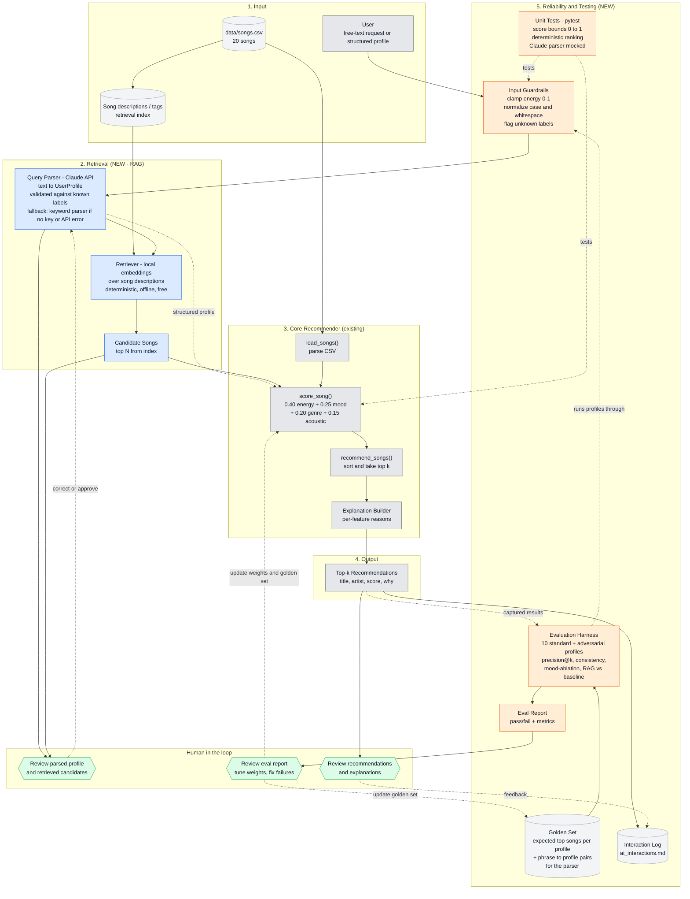

# System Architecture

This diagram shows the existing content-based recommender (grey) and the two planned enhancements: a **RAG retrieval layer** (blue) and a **reliability / testing system** (orange). Human checkpoints are shown in green.

## How to read it

**Data flow (input, process, output)**
1. The user's request passes through the input guardrails, which clamp and normalize it.
2. The Claude-powered query parser turns the request into a `UserProfile`, checked against the known genre and mood labels. If there is no API key or the call fails, a keyword parser takes over. The local embedding retriever then uses the profile and the song index to pull candidate songs, matching on meaning rather than exact labels.
3. The existing `score_song()` and `recommend_songs()` rank the candidates. Scoring stays deterministic and explainable.
4. The output is the top-k list with a reason for each score.

**Testing**
- **Unit tests** (pytest) cover the deterministic parts: guardrails and scoring.
- The **evaluation harness** runs the 10 standard and adversarial profiles through the full pipeline. It compares results to a golden set and to the non-RAG baseline, then writes a report.

**Human checkpoints**
- **H1** checks that the parsed profile and retrieved candidates make sense before ranking, since this is where RAG can go wrong.
- **H2** is the user or developer reading the recommendations and explanations, with feedback logged.
- **H3** reviews the eval report and decides on weight changes or golden-set updates. Nothing changes automatically.
